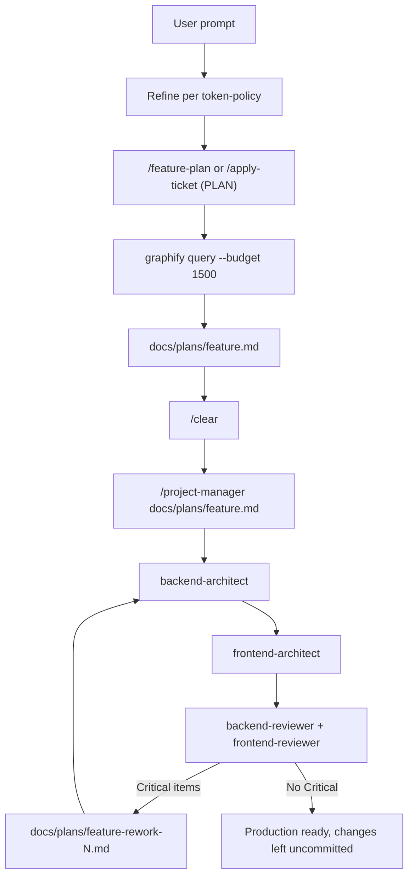

# Ticketboat Custom Claude Code Workflow

Shared Claude Code setup for Ticketboat projects. This repo holds the `.claude/` tree (rules, agents, skills, commands, hooks) and the `CLAUDE.md` that Claude Code loads in a multi-root workspace such as `admin-frontend`, `admin-api-python`, and `admin-api-csharp`.

It is the Claude Code port of the Cursor hub in `tb-custom-workflow` (`.cursor/`). The Cursor tree stays the source for Cursor; this tree is what Claude Code loads. When the workflow changes, update both.

## What this is about

The workflow does three things:

1. **Refine, then hand off.** Each request is first turned into a tight brief (objective, scope, constraints, forbidden), so commands and agents spend tokens on implementation, not on working out scope again. See `.claude/rules/token-policy.md`.
2. **Compounding cycle: Plan → Code → Review/Test → Plan.** Every phase ends with a written artifact. Plans live in `docs/plans/<feature>.md`. Reviewers return rework lists, and Critical items become a rework plan (`docs/plans/<feature>-rework-N.md`) that loops back through Code and Review until the work is production ready. See `.claude/rules/compounding-dev-cycle.md`.
3. **Graph-first orientation.** Each product repo can have a [Graphify](https://github.com/Graphify-Labs/graphify) knowledge graph. Agents query it instead of reading the whole tree again for every command. See `.claude/rules/graphify.md`.



### Modes

Cursor mode names map to these behaviors in Claude Code (`.claude/rules/claude-code.md`):

| Mode | Behavior |
|---|---|
| **ASK** | No file edits. Ask until scope and acceptance criteria are unambiguous. |
| **PLAN** | Edit only `docs/plans/**` (or the Linear issue, for `/refine-spec` and `/create-ticket`). No app code, builds, tests, or installs. |
| **AGENT (Code)** | Spawn `backend-architect`, then `frontend-architect`. They edit files and run tests. |
| **AGENT (Review)** | Spawn `backend-reviewer` and `frontend-reviewer`. Read-only; they return a rework list. |

### Why XML beats a single prose prompt

For complex work, `token-policy.md` asks for a short internal XML blueprint (`<role>`, `<task>`, `<forbidden>`, `<documents>`, `<error_handling>`, `<analysis>`, `<output_format>`). Unstructured text mixes role, task, constraints, and output in one stream, so the model blends them and drifts (rules read as content, examples override instructions). Named tags give each concern its own slot, which makes negative rules (`<forbidden>`, `<error_handling>`) as visible as positive ones. Separating `<analysis>` from `<output_format>` makes the model think before it answers. Frontier models are trained heavily on XML-style instruction documents, so this format tends to be followed more reliably than a paragraph with the same words and no delimiters.

## Tools involved

| Tool | Used for | Required |
|---|---|---|
| [Claude Code](https://claude.com/claude-code) (CLI, VS Code, or JetBrains) | Runs the workflow | Yes |
| [Graphify](https://github.com/Graphify-Labs/graphify) CLI (`graphifyy` on PyPI) | Per-repo knowledge graph: `graphify query`, `path`, `explain`, `update` | Strongly recommended |
| [uv](https://docs.astral.sh/uv/) | Installs the Graphify CLI | Recommended |
| Python 3 | Hook scripts (`session-init.sh` emits JSON with `python3`) | Yes |
| Linear MCP (claude.ai Linear connector) | `/apply-ticket`, `/refine-spec`, `/create-ticket` | For Linear commands |
| Product stacks | Python/FastAPI (ruff, black, mypy, pytest), C#/.NET 8 (xUnit/NUnit), React/Vite/TypeScript (pnpm, Vitest) | Per repo |

## Repository layout

```
CLAUDE.md                 Session contract, command table, subagent list
.claude/
  settings.json           Hook registration
  hooks/                  session-init.sh, audit.sh (audit.log is written here)
  rules/                  Always-on and path-scoped rules
  agents/                 Subagent definitions
  commands/               Slash commands
  skills/                 Skills loaded by commands, agents, or on demand
```

## Commands

Slash commands in `.claude/commands/`. All except `/trace-flow` set `disable-model-invocation`, so they run only when you type them.

| Command | Mode | What it does |
|---|---|---|
| `/feature-plan <slug>` | PLAN | Writes `docs/plans/<slug>.md` only (AC, File changes, tasks). |
| `/apply-ticket <issue>` | PLAN | Reads one Linear issue (read-only) and writes a plan. Stops after PLAN. |
| `/refine-spec <issue>` | PLAN | Tightens a Linear issue spec and updates the ticket. No product code. |
| `/create-ticket [title]` | PLAN | Creates one Linear issue. Clarifies vague input first. |
| `/project-manager <plan-path>` | AGENT | Runs Code → Review → rework until production ready. |
| `/new-task <task>` | — | Task breakdown and implementation plan in chat. Does not write `docs/plans/`. |
| `/api-new <endpoint>` | AGENT | New FastAPI endpoint with Pydantic validation, error handling, async. |
| `/api-test <endpoint>` | AGENT | pytest + httpx tests for an endpoint. |
| `/code-cleanup <file>` | AGENT | Refactor for readability and best practices (Python and TypeScript). |
| `/code-optimize <file>` | AGENT | Measure-first performance pass. |
| `/trace-flow <page or action>` | Read-only | Traces a page or action from route load through API, functions, DB, and UI to `docs/traces/<slug>.md`, with a flowchart. |

After `/feature-plan` or `/apply-ticket`, run `/clear`, then `/project-manager <plan-path>`, so the planning context does not carry into Code.

## Agents

Subagents in `.claude/agents/`, spawned with the Agent tool by `name`.

| Agent | Role | Tools |
|---|---|---|
| `backend-architect` | Designs and implements backend work. Picks Python (FastAPI) or C# (ASP.NET Core) from the plan or files in scope. | Read, Grep, Glob, Bash, Edit, Write, Skill |
| `frontend-architect` | Implements UI (React 18, Vite, Ant Design 5, Jotai, TanStack Query). | Read, Grep, Glob, Bash, Edit, Write, Skill |
| `backend-reviewer` | Reviews backend code per file language; returns Critical / Suggestion / Nice-to-have rework. | Read, Grep, Glob, Bash, Skill (read-only) |
| `frontend-reviewer` | Reviews UI for correctness, accessibility, performance, and standards. | Read, Grep, Glob, Bash, Skill (read-only) |
| `tech-stack-researcher` | Evaluates technology choices against the Ticketboat stack during planning. | Read, Grep, Glob, Bash, WebFetch, WebSearch, Skill |
| `technical-writer` | API references, guides, READMEs, runbooks. | Read, Grep, Glob, Bash, Edit, Write, Skill |

Reviewers have no Write or Edit tools, so they cannot apply changes.

## Skills

Skills in `.claude/skills/<name>/SKILL.md`.

| Group | Skills |
|---|---|
| Orchestration | `feature-planning`, `agent-selection`, `graphify-navigation`, `trace-flow` |
| Graph build | `graphify` (official `/graphify` skill: build, `--update`, wiki, hooks only; not for routine queries) |
| Backend skillsets | `backend-architect`, `backend-reviewer` (bundle api-design-patterns, postgresql, security-audit, code-review; Python adds api-testing) |
| Frontend skillsets | `frontend-architect`, `frontend-reviewer` (bundle accessibility-checklist, performance-profiling, code-review) |
| Shared | `api-design-patterns`, `api-testing`, `postgresql`, `security-audit`, `code-review`, `refactoring-checklist`, `requirements-discovery`, `docs-structure`, `performance-profiling`, `accessibility-checklist` |

## Rules

Rules in `.claude/rules/`. Files without `paths` frontmatter always load; files with `paths` load only when Claude works on matching files.

| Rule | Scope | Purpose |
|---|---|---|
| `token-policy.md` | Always | Refine → hand off, answer shape, citations over pastes, XML blueprints. Authoritative for agent communication. |
| `compounding-dev-cycle.md` | Always | Plan → Code → Review/Test → Plan, phase exits, production-ready gates. |
| `claude-code.md` | Always | ASK / PLAN / AGENT mode map for Claude Code. |
| `core-standards.md` | Always | Type safety, error handling, naming, UTC, no hard-coded secrets, parameterized SQL. |
| `graphify.md` | Always | Graphify phase budget and graph gate. |
| `python-backend.md` | `**/*.py` | Python 3.12+, FastAPI, Pydantic v2, async-first, tooling. |
| `api-routes-python.md` | `**/api/**/*.py` | FastAPI HTTP contract: validation, status codes, errors. |
| `csharp-backend.md` | `**/*.cs` | .NET 8+, ASP.NET Core, EF Core/Dapper. |
| `api-routes-csharp.md` | `**/Controllers/**/*.cs` | ASP.NET Core HTTP contract. |
| `react-frontend.md` | `**/*.tsx` | React component structure, state, Ant Design. |
| `typescript.md` | `**/*.ts` | Strict typing, ESM, zod at runtime boundaries. |

### Graphify phase budget

| Phase | Graphify use |
|---|---|
| ASK / PLAN | Required before Grep/Read. `graphify query "…" --budget 1500`, `path`, or `explain`. |
| Code | Plan-first. Read the plan's File changes; query only for gaps or blast radius. |
| Review | Diff-first. Query only for dependency or blast-radius questions. |
| After edits | `graphify update .` in each modified product root. |

## Hooks

Registered in `.claude/settings.json`. Both scripts exit 0 and never block a tool call.

| Event | Script | What it does |
|---|---|---|
| `SessionStart` | `session-init.sh` | Injects a one-line reminder: refine then hand off, Plan → Code → Review, graphify budget, `/feature-plan` → `/clear` → `/project-manager`. |
| `PreToolUse` (Bash), `PostToolUse` (Bash), `Stop`, `SessionEnd` | `audit.sh` | Appends `{"event", "timestamp"}` (UTC) to `.claude/hooks/audit.log`. Hook input is never logged, so commands and secrets stay out of the file. |

Add `.claude/hooks/audit.log` to `.gitignore` in any repo that installs this workflow.

## Setup

### 1. Install Claude Code

Follow the [Claude Code setup guide](https://docs.claude.com/en/docs/claude-code/setup), or install the VS Code or JetBrains extension.

### 2. Install the workflow into the workspace root

Claude Code reads `CLAUDE.md` and `.claude/` from the directory it starts in. Copy them into the folder that contains your product repos:

```bash
cd ~/Documents/Project/TicketBoat          # folder holding admin-frontend, admin-api-python, ...
cp tb-claude-custom-workflow/CLAUDE.md .
cp -R tb-claude-custom-workflow/.claude .
chmod +x .claude/hooks/*.sh
```

Expected layout:

```
TicketBoat/
  CLAUDE.md
  .claude/
  admin-frontend/
  admin-api-python/
  admin-api-csharp/
```

To install into a single product repo instead, copy the same two items into that repo's root.

### 3. Install Graphify and build a graph per product repo

Once per machine:

```bash
uv tool install graphifyy     # PyPI name is graphifyy; the CLI is graphify
uv tool update-shell          # if graphify is not on PATH
```

Once per product repo:

```bash
cd admin-frontend
graphify extract . --code-only    # or run /graphify . in Claude Code
graphify hook install             # optional: rebuild the graph on commit
```

Commit `graphify-out/` (except `cost.json`) so the team shares the graph. Without a graph, the workflow falls back to narrow Grep/Glob and asks you to build one.

### 4. Connect Linear (optional)

The Linear commands need the Linear MCP. Enable the Linear connector in your claude.ai connector settings, or add it with `claude mcp add`, then check it with `/mcp`.

### 5. Verify

Start Claude Code in the workspace root and confirm:

- The session opens with the Ticketboat reminder from `session-init.sh`.
- `/` lists `feature-plan`, `project-manager`, `apply-ticket`, and the other commands.
- `/agents` lists the six Ticketboat subagents.
- `.claude/hooks/audit.log` gains entries after a Bash call.

## Daily use

1. **Plan:** `/feature-plan <slug>` or `/apply-ticket <issue>` writes `docs/plans/<slug>.md`.
2. **Review the plan** yourself and edit it if needed.
3. `/clear`
4. **Build:** `/project-manager docs/plans/<slug>.md` runs Code, then Review, and loops on Critical rework.
5. **Commit:** Claude leaves changes uncommitted unless you ask. Review the diff, then commit and push yourself.

Other entry points: `/trace-flow` to understand an existing page before planning, `/refine-spec` to tighten a ticket before `/apply-ticket`, and `/api-new` or `/api-test` for single-endpoint work.

## Stacks

- **Python:** FastAPI, Pydantic v2, asyncpg, SQLAlchemy 2, Snowflake, Redis, Mangum (Lambda), pytest. Rules: `python-backend.md`, `api-routes-python.md`.
- **C#:** .NET 8+, ASP.NET Core, EF Core or Dapper, xUnit or NUnit. Rules: `csharp-backend.md`, `api-routes-csharp.md`.
- **Frontend:** React 18, Vite 6, TypeScript 5, Ant Design 5, Jotai, TanStack React Query, axios, styled-components, zod, pnpm, Vitest. Rules: `react-frontend.md`, `typescript.md`.

Deploy: ECS and S3 + CloudFront (Terraform), Bitbucket Pipelines. Auth: Firebase and MSAL (Azure AD). APM: New Relic.

## Maintaining

- Change the Cursor hub (`tb-custom-workflow/.cursor/`) and this tree together.
- Keep `CLAUDE.md`'s command and agent tables in sync with `.claude/commands/` and `.claude/agents/`.
- After editing this repo, copy the changed files into each installed workspace again.
